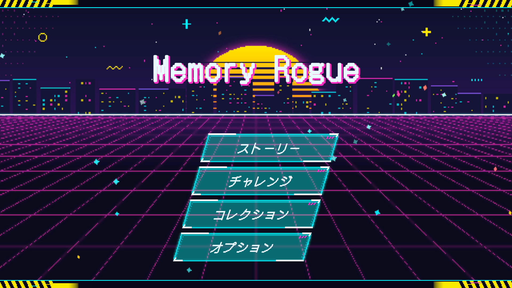
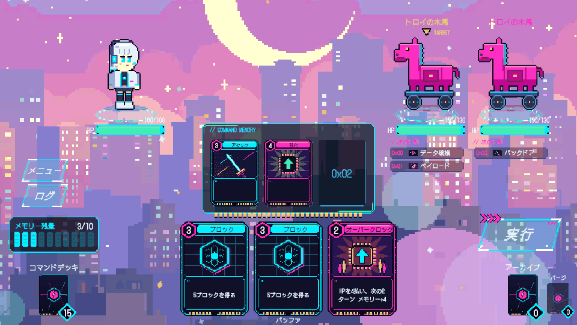
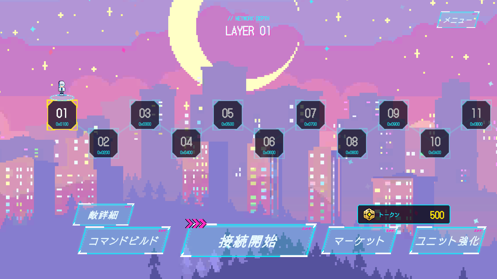
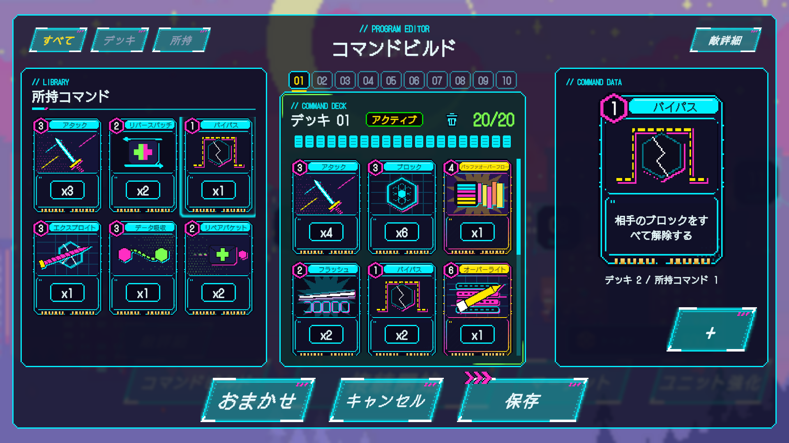

# Memory Rogue

**コマンドを組んで、ネットワークの深層へ。**
サイバー × ポップ × ピクセルの世界で遊ぶ、デッキ構築ローグライク。

▶️ **[ブラウザで遊ぶ](https://toriniku435.github.io/MemoryRogue/)**（PC 推奨）

| マップ | コマンドビルド |
| --- | --- |
|  |  |

## 🎮 どんなゲーム？

あなたはネットワークに潜るハッカー。
戦いに使うのはカードではなく **コマンド**。デッキを「プログラム」として組み上げ、ウイルスやトロイの木馬といった敵を倒しながら、階層を一つずつ奥へ進みます。

- 🧩 **デッキ構築** — 攻撃・防御・ウイルス・自己強化など 40 種以上のコマンドから、自分だけのデッキを組む
- 🗺️ **ローグライク** — 勝てば報酬で強くなり、負けても「バックアップブースト」で立て直せる
- 👀 **先読みバトル** — 敵の次の行動が見えるので、それに合わせて一手を考える
- 🏆 **スコアとランク** — クリア時の結果で E〜SSS のランクがつく

## 🕹️ 遊び方

### バトル

1. ターンの初めに、デッキから **バッファ**（手札）にコマンドが読み込まれる
2. コマンドをクリックすると、**コマンドメモリー**（最大 3 つ）に書き込まれる
   - コマンドは **メモリー残量** を消費する
   - 敵が複数いるときは、敵をクリックして優先ターゲットを選べる
3. **実行** を押すと、メモリーのコマンドが順に実行され、敵のターンへ
4. 敵の HP をすべて 0 にすれば勝利 🎉

> 💡 敵の頭上に「次の行動」が表示されている。ブロックで受けるか、先に倒し切るか。

### マップ

- 🔌 **接続開始** — 次の階層のバトルへ
- 🛠️ **コマンドビルド** — デッキの編集（最大 10 デッキを保存）
- 🛒 **マーケット** — トークンでチップ（コマンドのパック）や単品のコマンドを買う
- ⬆️ **ユニット強化** — HP とメモリー上限を上げる
- 🔍 **敵詳細** — 次の階層の敵の能力とコマンドを確認する

初めての方は、ストーリー開始時のチュートリアルがおすすめです。

## 🎲 モード

| モード | 内容 |
| --- | --- |
| 📖 ストーリー | エピソードごとに全 10 階層。最深部にはボスが待つ |
| ⚔️ チャレンジ | ノーマル（30 階層）/ ハード（60）/ マスター（100）/ エンドレス。敵はランダムで、10 階層ごとに強くなる。負けたら終わり |
| 📚 コレクション | 手に入れたコマンドと、戦った敵の図鑑 |

## 🖱️ 操作

| 操作 | マウス | タッチ |
| --- | --- | --- |
| コマンドを使う | クリック | 2 回タップ |
| 詳細を見る | カーソルを合わせる | 1 回タップ |
| 選択をやめる | 何もない場所をクリック | 何もない場所をタップ |

## 🛠️ 技術

- **Unity 6**（6000.3）/ URP / uGUI / C#
- 対応：Windows・Android・WebGL
- 日本語 / English 対応（Unity Localization）
- キャラクター・コマンド・UI のピクセルアートは、Python のコードで描いたオリジナル（`ArtSource/`）
- BGM・効果音・背景も自作の生成版を同梱（`SoundSource/` ほか）。ブラウザ版のみ Asset Store 素材に差し替え（下記クレジット）

コードの設計（MVP、シーン遷移、ウインドウの仕組みなど）は 👉 **[設計資料](docs/architecture.md)** にまとめています。

## 🎵 クレジット

ブラウザ版では、次の Unity Asset Store の素材を使用しています（Standard Unity Asset Store EULA）。
ライセンスの都合上、**このリポジトリには含まれていません**。ソースは自作の生成画像・生成音で動作します。

| 素材 | 制作 | 用途 |
| --- | --- | --- |
| [Cute Pop Electro Pack Vol.1](https://assetstore.unity.com/packages/audio/music/pop/cute-pop-electro-pack-vol-1-254913) | Rabbbbbbbbbbie | BGM |
| [The Complete UI Sound Effects Library](https://assetstore.unity.com/packages/audio/sound-fx/the-complete-ui-sound-effects-library-324429) | Celeris Lab | 効果音 |
| [Pixel Art City Backgrounds](https://assetstore.unity.com/packages/2d/environments/pixel-art-city-backgrounds-203049) | Eder | マップ・バトルの背景 |

フォント：[DotGothic16](https://fonts.google.com/specimen/DotGothic16)（SIL Open Font License 1.1）

## 📄 ライセンス

© 2026 toriniku435. All rights reserved.
ソースコードは閲覧・学習目的で公開しています。
